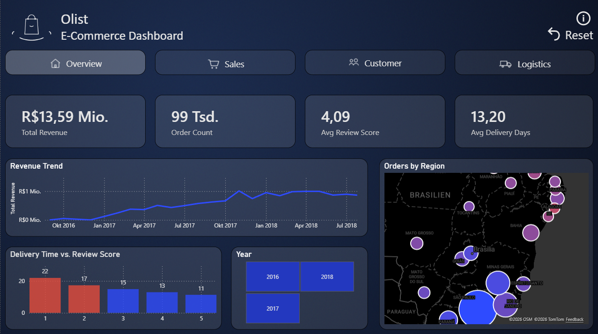
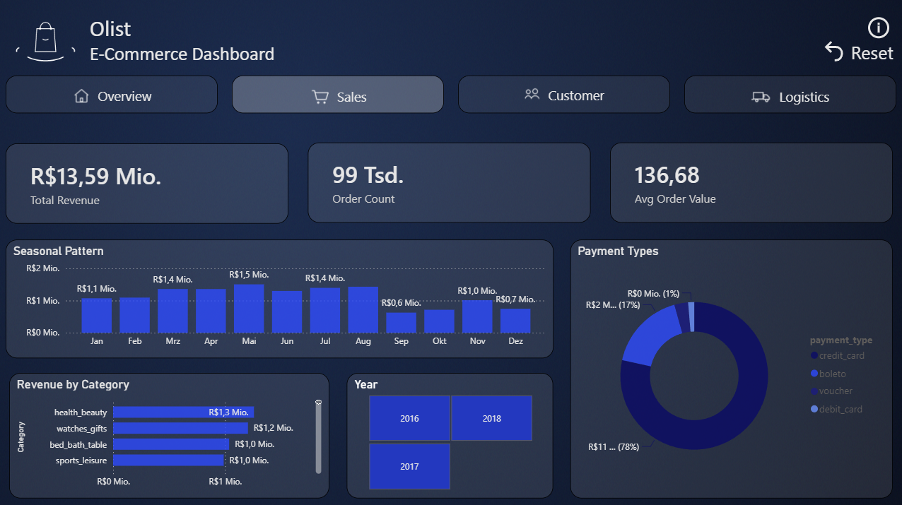
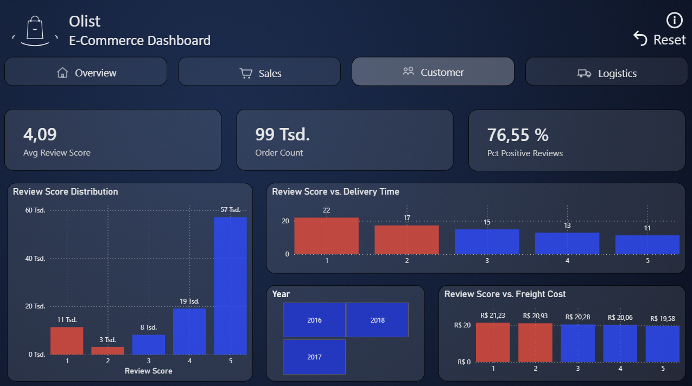
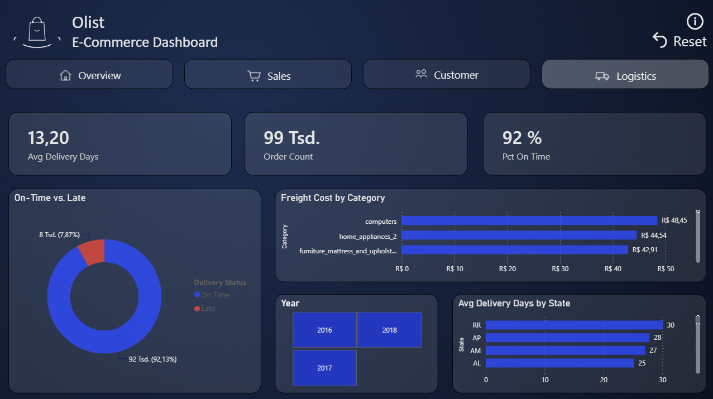

# Olist Brazilian E-Commerce — Data Analytics Project

End-to-end data analytics project on the **Brazilian E-Commerce Public Dataset by Olist**,
covering the full analyst workflow: data cleaning, exploratory analysis (EDA), SQL analysis,
machine learning, and a Power BI dashboard.

> **Data source:** [Brazilian E-Commerce Public Dataset by Olist](https://www.kaggle.com/datasets/olistbr/brazilian-ecommerce)
> **License:** CC BY-NC-SA 4.0 (non-commercial, attribution, share-alike)

**🔗 Live project page:** [todorvankov.com/olist-brazilian-e-commerce](https://todorvankov.com/olist-brazilian-e-commerce)

## Chapters

| Chapter | Status | Link |
| --- | --- | --- |
| 01 · Exploratory Data Analysis | ✅ Done | [notebooks/01_EDA.ipynb](notebooks/01_EDA.ipynb) · [Live report](https://todorvankov.com/olist-brazilian-e-commerce) |
| 02 · SQL Analysis | ✅ Done | [notebooks/02_SQL_Analysis.ipynb](notebooks/02_SQL_Analysis.ipynb) · [sql/](sql/) |
| 03 · ML Model (predict negative reviews) | ✅ Done | [notebooks/03_ML.ipynb](notebooks/03_ML.ipynb) |
| Power BI Dashboard | ✅ Done | [Jump to section](#power-bi-dashboard) · [powerbi/olist_dashboard.pbix](powerbi/olist_dashboard.pbix) |

---

## Project Goal

Analyze ~100k real orders from a Brazilian marketplace to understand what drives customer
satisfaction, and build a machine learning model to **predict negative reviews (1–2 stars)**.

## Key Findings (from EDA)

- **Delivery time is the #1 driver of satisfaction** — 1-star customers wait on average 20.8 days
  vs 10.2 days for 5-star customers (correlation −0.30).
- **Heavy geographic concentration** — 60% of sellers and 42% of customers are in São Paulo state.
- **Polarized reviews** — 58% give 5 stars, 12% give 1 star; neutral scores (2–3) are rare.
- **Brazilian payment culture** — credit card 74%, but boleto (bank slip) accounts for 19%.

---

## SQL Analysis

Six business questions answered in plain SQL (`JOIN`, `GROUP BY`, `CASE WHEN`, aggregates) on the
Olist SQLite database. Each query is stored in [`sql/`](sql/) and run with results in
[`02_SQL_Analysis.ipynb`](notebooks/02_SQL_Analysis.ipynb).

| # | Question | Result |
| --- | --- | --- |
| 1 | Revenue over time | R$ 13.59 M over 24 months (matches the Power BI KPI) |
| 2 | Top categories | `health_beauty` and `watches_gifts` lead; order count and revenue rank differently |
| 3 | Orders by state | São Paulo has 41,375 orders, more than RJ and MG combined |
| 4 | Delivery vs. reviews | On-time orders average **4.29 stars**, late ones only **2.57** |
| 5 | Payment methods | Credit card dominates; customers pay in 3.5 installments on average |
| 6 | Top sellers | 3,095 sellers, top 10 make up ~13% of revenue, 9 of them in São Paulo |

## Machine Learning — Predicting Bad Reviews

Goal: predict whether an order gets a **bad review (1–2 stars)**; only 12.8% of orders do, so the
classes are imbalanced (see [`03_ML.ipynb`](notebooks/03_ML.ipynb)). Two variants are compared:

| Variant | Information used | ROC-AUC | Precision (bad) |
| --- | --- | --- | --- |
| **A — at order time** | price, shipping, installments, promised delivery time, state | 0.61 | 0.19 |
| **B — after delivery** | A + actual delivery time and lateness | **0.74** | **0.39** |

- **Leakage-aware:** variant A uses only features known when the order is placed.
- **Models:** Logistic Regression (baseline) and Random Forest, with class weighting for the imbalance.
- **Takeaway:** the model is only moderately accurate — bad reviews are hard to predict at order time.
  Once the real delivery is known, the signal gets much stronger (`days_late` is the top feature),
  so the practical use is to **flag late deliveries on delivery day** and contact those customers
  before a bad review is written. A stronger algorithm did not help; the limit is the available information.

---

## Power BI Dashboard

A 4-page interactive dashboard built in Power BI, digging into the same data from four angles:
sales performance, customer satisfaction, and delivery logistics — tying back to the EDA finding
that delivery time drives reviews.

> Live web version isn't available (personal Power BI account can't enable public "Publish to Web").
> Download **[olist_dashboard.pbix](powerbi/olist_dashboard.pbix)** and open it in Power BI Desktop
> to explore it interactively — filters, drilldowns and the reset button all work.

### Overview
Revenue, order count, review score and delivery time at a glance, a revenue trend line, an
order-density map of Brazil, and the first look at the delivery-time-vs-review-score relationship.



### Sales
Revenue broken down by product category and by month (seasonal pattern, peaking in May), plus
the split of payment methods (credit card dominates at ~78%).



### Customer
Review score distribution (skewed toward 5★, but 1★ still outnumbers 2★), and how review score
relates to both delivery time and freight cost — both get worse for low-rated orders.



### Logistics
92% of orders arrive on time. Freight cost by category (bulky items like computers and furniture
cost the most to ship), and average delivery time by state — the slowest states are all in the
Amazon region (RR, AP, AM), consistent with the geographic concentration found in the EDA.



---

## Project Structure

```
Olist-Brazilian-E-Commerce/
├── data/
│   ├── raw/            # Kaggle CSVs + olist.sqlite (not in git — see setup)
│   └── processed/      # cleaned data
├── notebooks/
│   ├── 01_EDA.ipynb          # Exploratory Data Analysis
│   ├── 02_SQL_Analysis.ipynb # Business questions in SQL
│   └── 03_ML.ipynb           # Predicting negative reviews
├── sql/                # the 6 SQL queries
├── powerbi/            # Power BI dashboard (.pbix + screenshots)
├── reports/            # exported HTML reports
├── requirements.txt
└── README.md
```

## Setup

**1. Clone and install dependencies**
```bash
git clone https://github.com/tvankov/olist-brazilian-ecommerce.git
cd olist-brazilian-ecommerce
pip install -r requirements.txt
```

**2. Download the data** (not included in the repo — ~228 MB)

Requires a free [Kaggle API token](https://www.kaggle.com/docs/api):
```bash
cd data/raw
kaggle datasets download -d olistbr/brazilian-ecommerce --unzip
kaggle datasets download -d terencicp/e-commerce-dataset-by-olist-as-an-sqlite-database --unzip
```

**3. Run the notebooks** in `notebooks/`.

---

## Tech Stack

Python · pandas · NumPy · scikit-learn · Matplotlib · Seaborn · Plotly · SQLAlchemy · SQLite · SQL · Power BI

## Roadmap

- [x] `01_EDA.ipynb` — data cleaning & exploratory analysis
- [x] `02_SQL_Analysis.ipynb` — business questions in SQL
- [x] `03_ML.ipynb` — predicting negative reviews
- [x] Power BI dashboard

---

*Data © Olist, licensed under CC BY-NC-SA 4.0. This project is for educational / portfolio use only.*
